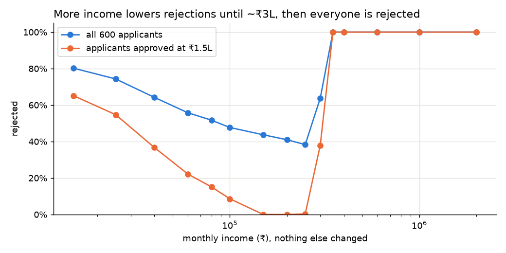
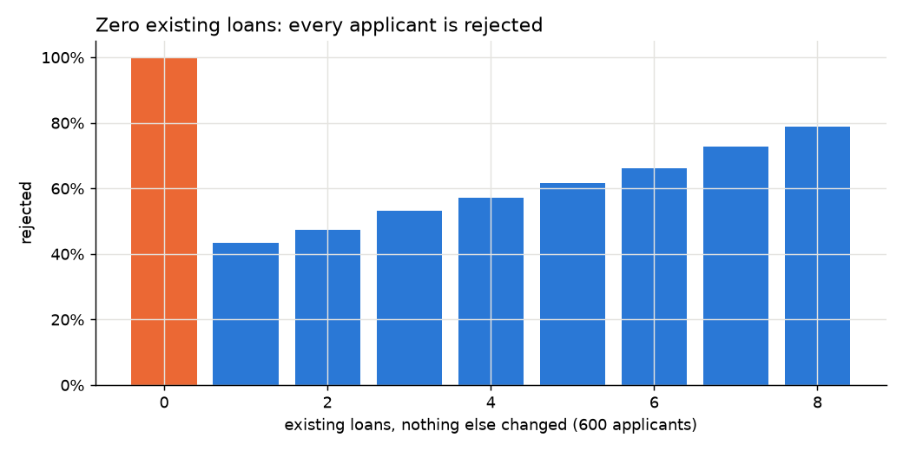
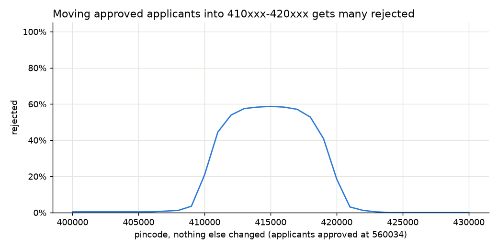
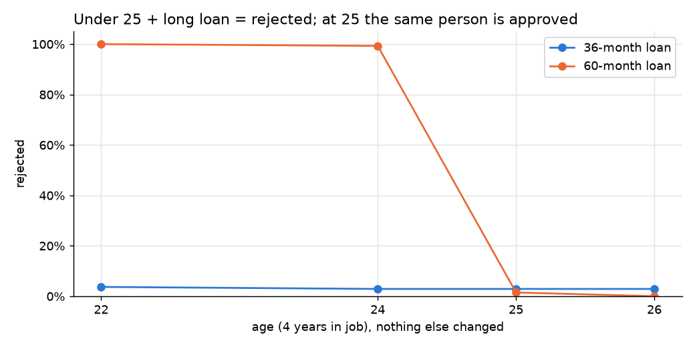

# Findings: Black-box model audit

**Name:**
**Time spent:**

## Summary
The model has learned four hidden "auto-reject" rules from the old decisions it was trained on:
1. Earning more than about ₹3 lakh a month.
2. Having no existing loans.
3. Living in pincodes around 410000–420000 (Pune / western Maharashtra) and asking for more than about ₹3 lakh.
4. Being under 25 and asking for a 4–5 year loan with 4 or fewer years in your job.

None of these is a sensible credit reason, and together they cause about **1 in 4 of the model's
rejections** on the validation set. The 98% accuracy did not catch this because the validation labels
contain the same rules, so the model is scored as "correct" for copying them. The model also gives
decisions for impossible inputs such as zero income. **My verdict: it should not stay in production
as an automatic approve/reject system.**

## How I approached it
I used the model only through `predict_batch` and never opened the model file.

1. **Looked at the labelled data first.** I checked which groups of applicants were approved or
   rejected (`01_eda.ipynb`). Three groups were rejected 100% of the time: zero existing loans, credit
   score below 633, and income of ₹3 lakh or more. A low credit score is a sensible reason. The other
   two looked wrong.
2. **Compared the model with the labels** (`02_model_vs_labels.ipynb`). It agrees 99.2% of the time,
   including 100% on the suspicious groups, so it had probably learned the same rules.
3. **"What-if" tests.** I took real applicants and changed **one** field at a time, keeping everything
   else the same, then counted how many decisions changed. Every test runs on hundreds of applicants.
4. When a change only affected some people, I looked at **who** was affected. Then I changed two or
   three fields together to confirm the exact combination.
5. For every rule I found, I went back and checked whether the labels contained it too.

Each experiment is a notebook in `experiments/` with its results already saved inside. To re-run them all: `python experiments/run_all.py` (about 40 seconds).
`LAB_NOTEBOOK.md` records each idea I tested, including the ones that turned out wrong.

---

## Finding 1: Earning more than about ₹3 lakh a month gets you rejected

**What it is:** When monthly income rises above about ₹3,00,000, the model's risk score jumps to
almost 1.0. At ₹3,50,000 or more, **every** applicant is rejected, whatever their credit score or
loan size.

**Evidence:**
- Experiment design: all 600 applicants, with only `monthly_income` changed across 15 values
  (₹15k to ₹20L) and the other 7 fields kept the same. I also tested the 338 applicants who are
  approved at ₹1.5L/month.
- Results:

| Monthly income | Rejected (all 600) | Rejected (338 approved at ₹1.5L) |
|---|---|---|
| ₹40,000 | 64% | 37% |
| ₹1,50,000 | 44% | 0% |
| ₹2,50,000 | 38% | 0.3% |
| ₹3,00,000 | 64% | 38% |
| **₹3,50,000 and above** | **100%** | **100%** |

  Raising income in ₹5,000 steps, the median point where a person flips to "reject" is ₹3,05,000.

  
- Code: `experiments/03_income.ipynb` (probe data: `probes/03_income_sweep.csv`)

**How I found it:** In the labelled data, all 22 applicants earning ₹3 lakh or more were rejected,
including some with excellent credit scores (800+). The highest income ever approved was
₹2,25,330. This matched the business complaint about well-off applicants, so I tested income
directly.

**Likely cause:** The old credit-team decisions rejected everyone above this income. Perhaps
high-income cases were sent to a different team and recorded as "reject" here, or were held for
income checks. The model copied that rule, and because the validation data has the same rule,
the test score looked perfect.

**Impact:** Every applicant earning more than about ₹3 lakh a month is rejected instantly and cannot
reapply for 90 days. That is 22 of 600 (3.7%) in the validation data. These are likely the safest and
most valuable customers, and it is the reason for the social-media complaints.

**Fix:** Ask the credit team what "reject" meant for these people and correct or remove those labels.
Retrain so that higher income can never increase risk. If high incomes really need an extra check,
send them to a human reviewer instead of rejecting them.

---

## Finding 2: Having no existing loans gets you rejected

**What it is:** If `existing_loans` is 0, the model rejects **every** applicant. The same person with
1–6 active loans is often approved, so being debt-free counts against you.

**Evidence:**
- Experiment design: all 600 applicants, with only `existing_loans` changed from 0 to 8 and
  everything else kept the same.
- Results:

| Existing loans | 0 | 1 | 2 | 4 | 6 | 8 |
|---|---|---|---|---|---|---|
| Rejected (all 600) | **100%** | 44% | 47% | 57% | 66% | 79% |
| Rejected (14 strong applicants*) | **100%** | 0% | 0% | 0% | 0% | 21% |

  \*credit score ≥ 780, income ₹60k–2L, small loan.

  All 339 applicants approved with 1 loan are rejected when that is changed to 0.

  
- Code: `experiments/04_existing_loans.ipynb` (probe data: `probes/04_existing_loans_sweep.csv`)

**How I found it:** In the labelled data, all 108 applicants with zero loans were rejected. I
thought this might be a sensible "no credit history" rule. I tested that idea and it was wrong:
zero-loan applicants have the same credit scores as everyone else (median 722 vs 715), so they do
have a credit history.

**Likely cause:** The old decisions applied a blanket rule like "no active loan → reject", or a 0 in
the source system meant "unknown". The model learned it as an on/off switch.

**Impact:** This is the biggest problem by number of people. 108 of 600 applicants (18%) have zero
loans, and **63 of them would be approved** if they had just one loan. Debt-free and first-time
borrowers are hit hardest.

**Fix:** Find out what 0 means in the source data. If it can mean "unknown", record that separately.
Correct the old labels and retrain. Add a test that going from 1 loan to 0 can never turn an approval
into a rejection.

---

## Finding 3: Pincodes around 410000–420000 get rejected for loans above about ₹3 lakh

**What it is:** For the same applicant, moving their pincode into roughly 410000–420000 (Pune and
western Maharashtra) gets them rejected when the loan is above about ₹3 lakh. Everywhere else,
pincode makes almost no difference.

**Evidence:**
- Experiment design: the 254 applicants the model approves at pincode 560034 (Bengaluru). I moved
  them to every pincode from 100000 to 999000 (steps of 1,000), changing nothing else. Then I
  compared pincode 560034 with 415000 at fixed loan amounts.
- Results: outside 40xxxx–42xxxx no pincode rejects more than 2.4% of them. Around
  414000–416000, **58%** are rejected. Loan amount is what decides who gets hit:

| Loan amount | Rejected at 560034 | Rejected at 415000 |
|---|---|---|
| ₹1,00,000 | 0.4% | 0.4% |
| ₹2,50,000 | 7.5% | 11.4% |
| ₹3,00,000 | 9.8% | **75.6%** |
| ₹4,00,000 | 15.0% | **100%** |
| ₹6,00,000 | 29.5% | **100%** |

  
- Code: `experiments/06_pincode.ipynb` (probe data: `probes/06_pincode_sweep.csv`)

**How I found it:** All 5 applicants where the model and labels disagree had pincodes starting with 40
or 41, and prefix 41 had the highest reject rate in the labels (85%). At first I suspected broad
regional bias, because label reject rates ranged from 30% to 85% across prefixes. That turned out to
be wrong: when the same people are moved around, only the 41xxxx area makes a difference. The other
differences came from different kinds of applicants living in each area.

**Likely cause:** In the old decisions, every 41xxxx applicant asking for more than ₹3 lakh was
rejected (17 out of 17). The model would reject only 41% of those same people at a different
pincode. This was probably an old, undocumented regional limit. The model also reads pincode as an
ordinary number, so nearby numbers such as 408xxx and 420xxx are partly penalised too.

**Impact:** 27 of 600 validation applicants live in 41xxxx. 8 of the model's rejections there are
caused **only** by the pincode. Pune is a large market for salaried borrowers, so the real number
could be higher. Rejecting people because of where they live is also a fairness and regulatory risk.

**Fix:** Stop feeding pincode to the model as a plain number. If location is really needed, use a
reviewed region-level risk measure. Correct the 41xxxx labels. Add a test that changing only the
pincode cannot change the decision.

---

## Finding 4: Under 25 + 4–5 year loan + 4 or fewer years in job gets you rejected

**What it is:** An applicant aged 21–24 who asks for a 48- or 60-month loan and has 4 or fewer years
of employment is almost always rejected. The same person at age 25 is almost always approved. Age
alone, or a long loan alone, does not do this. Only the combination does.

**Evidence:**
- Experiment design: 136 applicants approved at age 25. I changed age, loan tenure and years of
  employment in every combination, keeping everything else the same.
- Results:

| Loan tenure / years in job | Age 22 | Age 24 | Age 25 | Age 26 |
|---|---|---|---|---|
| 36 months / 4 years | 4% | 3% | 3% | 3% |
| 48 months / 4 years | **100%** | **98%** | 4% | 2% |
| 60 months / 4 years | **100%** | **99%** | 2% | 0% |
| 60 months / 5 years | 100% | 2% | 0% | 0% |

  
- Code: `experiments/07_age_tenure.ipynb`

**How I found it:** When I changed only age, 21–24-year-olds were rejected about 13 points more
often, while age had no effect from 25 to 62. I first thought this was a simple age penalty. But
when I looked at who was being rejected, they were all on 48- or 60-month loans with short job
histories, and the combination test above confirmed it.

**Likely cause:** An old policy like "no long loans to under-25s with short job history". In the
labels, all 25 applicants matching this combination were rejected, against 58% for everyone else.

**Impact:** 16 of the model's 53 rejections of under-25s in the validation set are caused by age
alone. One birthday changes the outcome, and the applicant is never told that a shorter loan would
have been approved. A hard age cut-off is difficult to justify to customers or regulators.

**Fix:** If this policy is real, write it down as an explicit rule and offer a shorter tenure instead
of rejecting. If not, correct the labels and retrain.

---

## Finding 5: The 98% accuracy is misleading

**What it is:** The validation data was labelled the same way as the training data, so it contains
the same four rules. The model gets full marks for copying them, which means the accuracy number
cannot reveal any of Findings 1–4.

**Evidence:**
- Experiment design: for every applicant the model rejects, I removed one flaw (zero loans → 1,
  income → ₹2.5L, 41xxxx → 560034, age → 25) and scored them again.
- Results:

| Flaw | Applicants with it | Rejected | Approved once the flaw is removed |
|---|---|---|---|
| Zero existing loans | 108 | 108 | 63 |
| Income over ₹2.5L | 23 | 23 | 5 |
| Pincode 41xxxx | 27 | 21 | 8 |
| Age under 25 | 67 | 53 | 16 |

  **91 of the model's 355 rejections (25.6%) are caused by one of these flaws alone**, and on those
  91 the model still agrees with the labels 98.9% of the time. Overall agreement is 99.2%, and 94% of
  risk scores are below 0.01 or above 0.99. The model is near-certain because it is copying fixed rules.
- Code: `experiments/09_impact.ipynb`, `experiments/02_model_vs_labels.ipynb`

**How I found it:** The model agreed with the labels on 100% of every suspicious group, which made
me ask what the accuracy number was actually measuring.

**Likely cause:** The model was trained and tested on past decisions, not on whether people actually
repaid. Any bias in past decisions passes straight into both training and testing.

**Impact:** The number that justified putting the model into production could not have caught any of
these problems. A fixed model would actually score lower on this test.

**Fix:** Test against real repayment outcomes, not past decisions. Before every release, also run
behaviour tests: more income must never mean more risk, changing only the pincode must not change
the decision, and so on.

---

## Finding 6: Impossible inputs get a decision instead of an error

**What it is:** The model accepts any number and returns a confident decision, even for inputs that
cannot be real.

**Evidence:**
- Experiment design: the 245 applicants the model approves, with one field set to an impossible value.
- Results:

| Input | Still approved |
|---|---|
| monthly_income = 0 | **23%** |
| loan_amount = 0 or −₹1,00,000 | 100% |
| tenure = 13 months (not a product) | 52% |
| age = 120 | 73% |
| age = 5, credit score = 2000, pincode = 9999999 | 0–2% |

- Code: `experiments/08_bad_inputs.ipynb`

**How I found it:** I was testing extreme values to look for more cliffs, and noticed that nothing
was ever refused.

**Likely cause:** `blackbox.py` only checks that all 8 fields are present, not that the values make
sense.

**Impact:** A form bug or a typo becomes a real loan decision. Someone with zero income can be
approved. This is less serious than Findings 1–4 because real inputs should be valid, but it is cheap
to fix.

**Fix:** Check every input against allowed ranges before scoring, and send anything invalid to a human.

---

## Things I tested that turned out fine
- **Credit score works correctly.** Higher score means fewer rejections (100% at 500, 27% at 900).
- **Loan amount works correctly.** Bigger loan means more rejections (34% at ₹50k, nearly 100% at ₹40L).
- **Loan tenure is mostly fine.** Longer loans (smaller EMI) mean fewer rejections (80% at 12 months,
  46% at 60). The one odd step was Finding 4.
- **Years employed is fine.** More years means fewer rejections (65% at 0 years, 49% at 10–20).
- **Age outside Finding 4 is fine.** No effect from 25 to 62 (56–57% rejected at every age).
- **Other regions are fine.** No pincode outside 40xxxx–42xxxx changes rejections by more than 2.4%.
- **The model is not jumpy.** On 400 random applicants, +₹1 income changed 0 decisions, +1 credit
  point 0.5%, +₹5,000 loan 0.5%, pincode +1 0.25% (`08_bad_inputs.ipynb`).
- **The data itself is clean.** No duplicate rows, no impossible values (`01_eda.ipynb`).

## Open questions
- What did "reject" mean in the old process for high earners and for the 41xxxx area: a real decline,
  or a hand-off to another team? Only the credit team or the raw application records can tell us.
- Loan amounts in the data stop at exactly ₹40 lakh, and a ₹1 crore request is always rejected. Is
  this a product limit or another hidden rule?
- With only 600 labelled rows, rarer combinations of inputs may hide more rules that I could not see.

## Verdict
**No, the model should not stay in production making automatic decisions.** About 1 in 4 of its
rejections happen for reasons that have nothing to do with whether the person can repay. The people
hit are high earners, people with no existing loans, people from one region, and young people on
longer loans, and each of them is locked out for 90 days. The 98% accuracy gave false confidence
because it was measured against the same flawed decisions.

**What I would do this week:**
1. Stop automatic rejections. Send model rejections to a human reviewer, or at least those in the
   four affected groups, and lift their 90-day lock.
2. Re-check recent rejections in those groups and contact the people who were wrongly declined.
3. Add input checks before the model.
4. Work with the credit team to find where each rule came from. Then fix the labels (ideally using
   real repayment data), drop pincode as a number, retrain, and run the behaviour tests in
   `experiments/` before every release.
